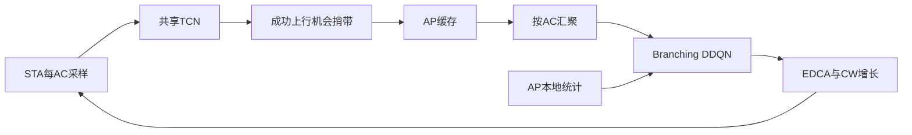

# Wi-Fi时序状态压缩反馈与DDQN信道接入实验报告

> 2026-10-19 数据有效性补充：旧后端漏记部分拒绝入队丢包，新后端现已[修复并验证](丢包记账修复_20261019.md)。本报告保留历史数值，旧 drop rate 及依赖它的 reward/训练结论仍需重新验证，不能因源码修复而视作历史结果已修正。成功包时延另受 10 秒寿命和评估截止影响，不能当作全部生成包的服务时延。原诊断详见[Baseline 核查](Baseline核查_20261019.md)。

本报告仅使用 `D:\compress_DRL_EDCA\results\raw\quick_20261018_141420` 中保留的原始CSV。当前模式为 **quick**；quick只验证流程和初步趋势，不构成收敛或正式性能结论。

## 1 实验目的

分别检验时序状态压缩、异步陈旧报告、显式report age对EDCA控制的影响。没有Decoder，也不以重构R²作为研究目标。

## 2 系统框架

## 3 EDCA仿真设置

采用ns-3.44 Wi-Fi，单BSS、1 AP、10 STA、20 MHz 802.11a，数据54 Mbps、控制6 Mbps。ACK开启，主场景RTS/CTS关闭、无隐藏节点，不额外注入PHY随机丢包；无A-MPDU/Block Ack。四AC独立队列和EDCAF。retry limit=7，队列限额100/200/500/500包，生存期10 s。Profile标准参数来自旧项目，已保留64行完整参数表。

C_ref重新标定为 **27.30225 Mbps**。四场景负载因子为0.55/0.85/0.85/1.20。复用原AC比例及UL/DL混合，S1仍以BE为主，并非四类业务各占25%。Poisson到达；VO/BE/BK为160/1500/1600B，VI为裁剪对数正态。

## 4 STA观测

每100ms记录队列字节末值、成功包MAC入队至ACK时延均值、Retry增量、Failed增量、Discarded增量及Delay Validity。没有有效时延时delay=0、valid=0。10个采样点构成每AC的10×6窗口。log1p及标准化参数只从训练采集数据拟合。

## 5 压缩方法

所有STA及AC共享一套TCN：3个因果残差卷积块，32通道、kernel=3、dilation=1/2/4，时间均值池化后输出每AC8维。四AC合计32个FP32分量。训练由TD loss反向传播；episode内冻结，统一阶段末更新Encoder版本。没有重构预训练。

## 6 AP输入

按AC对STA表示进行共享MLP、单头attention pooling和max pooling；附带有效报告的age均值、P95和coverage。STA编号置换不改变汇聚结果。AP同时使用自身PHY忙比例、接收失败代理、全网成功吞吐、公平性、活跃比例、各AC吞吐及自身下行队列。最近1s和整个决策周期分别统计。AP不读取STA当前队列填补陈旧报告。

## 7 DDQN动作

16组Profile以及alpha∈{1,2,3}、beta1∈{1.0,1.2,…,2.0}、beta2∈{1.0,1.2,…,3.0}、gamma∈{5,6,7}。beta2>=beta1通过联合约束掩码保证。CW失败时按分段倍率ceil增长并受CWmax限制，超过gamma保持，成功后恢复CWmin。完整Profile参数见[参数表](EDCA_Profile参数表.md)。

## 8 Reward

`r = 1.5 U - 0.5 c - 0.5 l - 0.8 d_vo - 0.6 d_vi - 0.2(1-Jain) - 0.02 s`。U按活跃AC的吞吐满足度加权，权重1.2/1.1/1.0/0.5；VO/VI时延门限20/50ms，超限比例截断到[0,2]。无成功时延样本时惩罚为0且记录无效，过载失败通过drop等项体现。所有主体指标均为比例或速率。

## 9 EDCA正确性测试

当前802.11a范围通过DCF/EDCA、信道访问、队列、non-HT TXOP上游测试及七类场景检查。隐藏节点吞吐约从20.23降至11.00 Mbps，RTS/CTS恢复至19.28 Mbps。BEB等效参数与标准BEB统计相同。详见[正确性检查](EDCA仿真正确性检查.md)。完整HE TXOP套件曾越界，未被宣称通过。

## 10 训练过程

训练种子：[1, 2]；评估种子：[101, 102]。每个学习方法独立训练，共享同一组研究定义。Quick使用4阶段×4 episode×10.0s，不能据此宣称已收敛。检查TD loss、梯度、latent方差和各seed性能后决定是否推进正式训练。每次实验保存配置、原始CSV、checkpoint、seed和运行时间。

横坐标是训练episode编号，纵坐标是该episode平均reward。淡线保留每个训练seed原值，粗线为跨seed均值的最近4个episode滑动平均，不同颜色和线型对应五种学习方法。场景随机切换也会引起reward波动，不能把平滑曲线上升直接视为策略收敛；需结合固定场景独立评估和TD诊断。

横坐标为梯度更新次数，纵坐标为五个动作分支的Smooth L1 TD loss。淡线是每个minibatch原值，实线为最近20次更新滑动平均，不同颜色对应独立训练seed。loss下降只说明当前replay与bootstrap目标下的拟合误差降低，不能证明策略收敛。

| 训练seed | episode数 | 决策步数 | 更新数 | 目标网络同步数 | 末步epsilon | 前50次平均loss | 后50次平均loss |
|---|---|---|---|---|---|---|---|
|1|16|160|300|0|0.055937|0.2469|0.037776|
|2|16|160|300|0|0.055937|0.15991|0.0064496|

**本轮quick尚未经历第一次目标网络同步。** 目标网络每500次更新同步一次，而本轮仅300次更新；因此这组数据不能验证多轮目标网络更新后的学习稳定性。训练过程也尚无按checkpoint生成的独立评估曲线。目前只确认短程loss下降、数值有限及流程可运行，不能写成已收敛。

[全部五种学习方法的逐seed Q loss](../results/figures/quick_20261018_141420/q_loss_all.png)

## 11 核心对比结果

95%区间使用Student t：学习方法先对同一训练seed的评估seed取均值，再跨独立训练seed计算；Default直接跨评估seed。仅两个seed时区间很宽是预期现象，不能据此宣称显著优越。区间可能超出物理范围，保留原值而不截断美化。

Full-State Fresh是信息充分的参考，有限训练预算下并不是严格性能上界。若Raw Async或压缩方法优于它，可能包含优化难度、随机初始化和动作探索的影响，不能直接认定减少信息本身提高性能。需充分训练、多seed及动作分布共同解释。

### Goodput (Mbps)

| 方法 | S1 | S2 | S3 | S4 |
|---|---|---|---|---|
|Default EDCA|14.93 ± 1.4|13.05 ± 0.321|23.12 ± 1.62|15.82 ± 0.575|
|Full-State Fresh|14.93 ± 0.00422；+0.01%|15.87 ± 0.471；+21.54%|22.98 ± 1.8；-0.62%|17.77 ± 0.00391；+12.34%|
|Raw Async|14.93 ± 0.00381；+0.00%|17.51 ± 0.886；+34.11%|23.11 ± 0.0349；-0.02%|19.04 ± 1.25；+20.32%|
|Compressed Fresh|14.93 ± 0.00366；-0.01%|16.79 ± 12.5；+28.63%|22.77 ± 4.49；-1.53%|18.51 ± 8.86；+17.01%|
|Compressed Async No-Age|14.93 ± 0.00422；-0.00%|16.08 ± 14.4；+23.16%|22.98 ± 1.65；-0.60%|18.15 ± 8.01；+14.72%|
|Compressed Async + Age|14.93 ± 0.00192；+0.01%|16.14 ± 14.5；+23.61%|23.12 ± 0.0159；-0.02%|18.16 ± 8.21；+14.76%|

表中百分比为相对Default均值的变化，负值表示降低；并非显著性检验。baseline为零时为N/A。

横坐标为四个业务场景S1–S4，纵坐标为Goodput (Mbps)；不同颜色、线型和标记对应六种方法，误差线为95%置信区间。先比较同一场景内的方法，再检查差异是否跨seed稳定。当前quick曲线只能支持数值比较，不能代替正式显著性结论。

### Collision rate

| 方法 | S1 | S2 | S3 | S4 |
|---|---|---|---|---|
|Default EDCA|0.06051 ± 0.0141|0.5035 ± 0.00934|0.1501 ± 0.0459|0.415 ± 0.0481|
|Full-State Fresh|0.05172 ± 0.159；-14.52%|0.2507 ± 0.232；-50.20%|0.09992 ± 0.248；-33.44%|0.2006 ± 0.0443；-51.66%|
|Raw Async|0.04855 ± 0.0697；-19.75%|0.2151 ± 0.154；-57.27%|0.1033 ± 0.277；-31.17%|0.2197 ± 0.178；-47.06%|
|Compressed Fresh|0.03739 ± 0.0247；-38.20%|0.2219 ± 0.411；-55.93%|0.07726 ± 0.0951；-48.54%|0.2045 ± 0.0569；-50.72%|
|Compressed Async No-Age|0.04026 ± 0.0696；-33.46%|0.2781 ± 0.49；-44.77%|0.08386 ± 0.113；-44.14%|0.2447 ± 0.0564；-41.05%|
|Compressed Async + Age|0.03966 ± 0.0459；-34.46%|0.2717 ± 0.415；-46.04%|0.08788 ± 0.0911；-41.46%|0.2454 ± 0.0573；-40.86%|

表中百分比为相对Default均值的变化，负值表示降低；并非显著性检验。baseline为零时为N/A。

横坐标为四个业务场景S1–S4，纵坐标为Collision rate；不同颜色、线型和标记对应六种方法，误差线为95%置信区间。先比较同一场景内的方法，再检查差异是否跨seed稳定。当前quick曲线只能支持数值比较，不能代替正式显著性结论。

### Drop rate

| 方法 | S1 | S2 | S3 | S4 |
|---|---|---|---|---|
|Default EDCA|0 ± 0|0.035 ± 0.0161|2.174e-05 ± 0.000276|0.007552 ± 0.00794|
|Full-State Fresh|0 ± 0；变化N/A|0.002648 ± 0.0153；-92.43%|0 ± 0；-100.00%|0.000229 ± 0.0021；-96.97%|
|Raw Async|0 ± 0；变化N/A|0.002251 ± 0.0139；-93.57%|0 ± 0；-100.00%|0.0007143 ± 0.00528；-90.54%|
|Compressed Fresh|0 ± 0；变化N/A|0.0008163 ± 0.00771；-97.67%|0 ± 0；-100.00%|0.0001493 ± 0.000272；-98.02%|
|Compressed Async No-Age|0 ± 0；变化N/A|0.004149 ± 0.00463；-88.14%|1.087e-05 ± 0.000138；-50.00%|0.0007354 ± 0.00366；-90.26%|
|Compressed Async + Age|0 ± 0；变化N/A|0.003249 ± 0.0109；-90.72%|0 ± 0；-100.00%|0.0009003 ± 0.00535；-88.08%|

表中百分比为相对Default均值的变化，负值表示降低；并非显著性检验。baseline为零时为N/A。

横坐标为四个业务场景S1–S4，纵坐标为Drop rate；不同颜色、线型和标记对应六种方法，误差线为95%置信区间。先比较同一场景内的方法，再检查差异是否跨seed稳定。当前quick曲线只能支持数值比较，不能代替正式显著性结论。

### Jain fairness

| 方法 | S1 | S2 | S3 | S4 |
|---|---|---|---|---|
|Default EDCA|0.9992 ± 0.000854|0.9991 ± 0.000987|0.9995 ± 0.00334|0.9982 ± 0.00451|
|Full-State Fresh|0.9992 ± 2e-05；+0.00%|0.999 ± 0.00166；-0.01%|0.9994 ± 1.07e-05；-0.00%|0.9991 ± 0.00348；+0.09%|
|Raw Async|0.9992 ± 6.1e-06；+0.00%|0.9996 ± 0.000152；+0.05%|0.9994 ± 3.5e-06；-0.00%|0.9993 ± 0.00524；+0.11%|
|Compressed Fresh|0.9992 ± 4.62e-06；+0.00%|0.9994 ± 0.00131；+0.03%|0.9995 ± 0.000334；+0.00%|0.9991 ± 0.00132；+0.09%|
|Compressed Async No-Age|0.9992 ± 2e-05；+0.00%|0.9992 ± 0.00131；+0.01%|0.9995 ± 7.87e-05；+0.00%|0.9994 ± 0.00077；+0.12%|
|Compressed Async + Age|0.9992 ± 2.49e-05；+0.00%|0.9994 ± 0.00195；+0.03%|0.9995 ± 2.56e-05；+0.00%|0.9993 ± 0.00117；+0.11%|

表中百分比为相对Default均值的变化，负值表示降低；并非显著性检验。baseline为零时为N/A。

横坐标为四个业务场景S1–S4，纵坐标为Jain fairness；不同颜色、线型和标记对应六种方法，误差线为95%置信区间。先比较同一场景内的方法，再检查差异是否跨seed稳定。当前quick曲线只能支持数值比较，不能代替正式显著性结论。

### VO p95 delay (ms)

| 方法 | S1 | S2 | S3 | S4 |
|---|---|---|---|---|
|Default EDCA|0.6686 ± 0.0131|8.408 ± 1.47|0.9863 ± 0.109|4.263 ± 1.46|
|Full-State Fresh|0.8193 ± 2.11；+22.55%|7.964 ± 1.99；-5.28%|1.272 ± 3.23；+28.98%|4.341 ± 0.104；+1.83%|
|Raw Async|0.6343 ± 1.21；-5.12%|13.4 ± 3.6；+59.43%|0.937 ± 4.44；-5.01%|9.583 ± 5.9；+124.78%|
|Compressed Fresh|1.011 ± 2.44；+51.21%|10.13 ± 21.6；+20.43%|1.489 ± 5.06；+50.99%|7.085 ± 22.4；+66.19%|
|Compressed Async No-Age|0.7056 ± 1.89；+5.55%|8.414 ± 40.5；+0.08%|1.09 ± 2.9；+10.48%|5.789 ± 32.5；+35.78%|
|Compressed Async + Age|0.7606 ± 2.32；+13.77%|8.593 ± 42.7；+2.21%|1.266 ± 5.6；+28.37%|5.807 ± 31.7；+36.21%|

表中百分比为相对Default均值的变化，负值表示降低；并非显著性检验。baseline为零时为N/A。

### VI p95 delay (ms)

| 方法 | S1 | S2 | S3 | S4 |
|---|---|---|---|---|
|Default EDCA|1.132 ± 0.277|15.51 ± 0.756|1.846 ± 0.38|8.311 ± 0.361|
|Full-State Fresh|1.173 ± 0.769；+3.61%|18.68 ± 24.6；+20.45%|1.842 ± 1.3；-0.20%|8.581 ± 1.34；+3.25%|
|Raw Async|0.996 ± 1.16；-12.00%|28.56 ± 1.35；+84.19%|1.401 ± 5.37；-24.10%|19.58 ± 21.6；+135.60%|
|Compressed Fresh|1.448 ± 1.05；+27.97%|22.76 ± 61.4；+46.77%|2.092 ± 4.1；+13.32%|13.21 ± 39.4；+58.94%|
|Compressed Async No-Age|1.072 ± 1.99；-5.30%|17.91 ± 80；+15.50%|1.645 ± 3.15；-10.86%|10.68 ± 59；+28.45%|
|Compressed Async + Age|1.087 ± 1.88；-3.94%|16.69 ± 85.4；+7.63%|1.692 ± 5.63；-8.31%|11.09 ± 64.7；+33.44%|

表中百分比为相对Default均值的变化，负值表示降低；并非显著性检验。baseline为零时为N/A。

### Mean report age (s)

| 方法 | S1 | S2 | S3 | S4 |
|---|---|---|---|---|
|Default EDCA|0 ± 0|0 ± 0|0 ± 0|0 ± 0|
|Full-State Fresh|0 ± 0；变化N/A|0 ± 0；变化N/A|0 ± 0；变化N/A|0 ± 0；变化N/A|
|Raw Async|0.0557 ± 0.00401；变化N/A|0.06689 ± 0.00879；变化N/A|0.05359 ± 0.0353；变化N/A|0.06232 ± 0.0236；变化N/A|
|Compressed Fresh|0 ± 0；变化N/A|0 ± 0；变化N/A|0 ± 0；变化N/A|0 ± 0；变化N/A|
|Compressed Async No-Age|0.05533 ± 0.0138；变化N/A|0.06032 ± 0.00371；变化N/A|0.05224 ± 0.0274；变化N/A|0.05711 ± 0.0267；变化N/A|
|Compressed Async + Age|0.05428 ± 0.0174；变化N/A|0.06146 ± 0.0274；变化N/A|0.05376 ± 0.0193；变化N/A|0.0574 ± 0.03；变化N/A|

表中百分比为相对Default均值的变化，负值表示降低；并非显著性检验。baseline为零时为N/A。

横坐标为四个业务场景S1–S4，纵坐标为Mean report age (s)；不同颜色、线型和标记对应六种方法，误差线为95%置信区间。先比较同一场景内的方法，再检查差异是否跨seed稳定。当前quick曲线只能支持数值比较，不能代替正式显著性结论。

### FP32 equivalent bytes/s

| 方法 | S1 | S2 | S3 | S4 |
|---|---|---|---|---|
|Default EDCA|0 ± 0|0 ± 0|0 ± 0|0 ± 0|
|Full-State Fresh|9600 ± 0；变化N/A|9600 ± 0；变化N/A|9600 ± 0；变化N/A|9600 ± 0；变化N/A|
|Raw Async|8.873e+04 ± 305；变化N/A|9.005e+04 ± 4.88e+03；变化N/A|9.103e+04 ± 305；变化N/A|9.101e+04 ± 610；变化N/A|
|Compressed Fresh|1280 ± 0；变化N/A|1280 ± 0；变化N/A|1280 ± 0；变化N/A|1280 ± 0；变化N/A|
|Compressed Async No-Age|1.182e+04 ± 40.7；变化N/A|1.195e+04 ± 40.7；变化N/A|1.214e+04 ± 122；变化N/A|1.208e+04 ± 0；变化N/A|
|Compressed Async + Age|1.183e+04 ± 0；变化N/A|1.2e+04 ± 40.7；变化N/A|1.214e+04 ± 40.7；变化N/A|1.21e+04 ± 163；变化N/A|

表中百分比为相对Default均值的变化，负值表示降低；并非显著性检验。baseline为零时为N/A。

横坐标为四个业务场景S1–S4，纵坐标为FP32 equivalent bytes/s；不同颜色、线型和标记对应六种方法，误差线为95%置信区间。先比较同一场景内的方法，再检查差异是否跨seed稳定。当前quick曲线只能支持数值比较，不能代替正式显著性结论。

### VO 时延CCDF

横坐标为成功包从MAC入队至ACK的时延（ms），纵坐标为超过该时延的概率P(D>x)，使用对数轴。四个子图是S1–S4，不同曲线对应各方法；曲线越靠左下，成功包时延尾部越小。先在每个训练seed内等权平均评估seed的CCDF，再等权平均训练seed。未成功包不在分布内，必须结合丢包率和队列解读；零概率只保留在CSV，不画到对数轴上。

### VI 时延CCDF

横坐标为成功包从MAC入队至ACK的时延（ms），纵坐标为超过该时延的概率P(D>x)，使用对数轴。四个子图是S1–S4，不同曲线对应各方法；曲线越靠左下，成功包时延尾部越小。先在每个训练seed内等权平均评估seed的CCDF，再等权平均训练seed。未成功包不在分布内，必须结合丢包率和队列解读；零概率只保留在CSV，不画到对数轴上。

### BE 时延CCDF

横坐标为成功包从MAC入队至ACK的时延（ms），纵坐标为超过该时延的概率P(D>x)，使用对数轴。四个子图是S1–S4，不同曲线对应各方法；曲线越靠左下，成功包时延尾部越小。先在每个训练seed内等权平均评估seed的CCDF，再等权平均训练seed。未成功包不在分布内，必须结合丢包率和队列解读；零概率只保留在CSV，不画到对数轴上。

### BK 时延CCDF

横坐标为成功包从MAC入队至ACK的时延（ms），纵坐标为超过该时延的概率P(D>x)，使用对数轴。四个子图是S1–S4，不同曲线对应各方法；曲线越靠左下，成功包时延尾部越小。先在每个训练seed内等权平均评估seed的CCDF，再等权平均训练seed。未成功包不在分布内，必须结合丢包率和队列解读；零概率只保留在CSV，不画到对数轴上。

### 仅baseline与完整方案的对比

相对变化=(完整方案−baseline)/|baseline|×100%；改善率按指标方向调整，正值改善、负值恶化。baseline为0或时延无成功样本时百分比为N/A。这里只比较实测均值，不表示统计显著。

| 场景 | 指标 | baseline | 完整方案 | 相对变化 | 改善率 |
|---|---|---:|---:|---:|---:|
|S1|goodput_mbps|14.93|14.93|+0.005029%|+0.005029%|
|S1|collision_rate|0.06051|0.03966|-34.46%|+34.46%|
|S1|drop_rate|0|0|N/A|N/A|
|S1|jain_fairness|0.9992|0.9992|+0.000302%|+0.000302%|
|S1|reward|1.468|1.473|+0.3625%|+0.3625%|
|S1|report_age_mean_s|0|0.05428|N/A|N/A|
|S1|fp32_equivalent_bytes_per_s|0|1.183e+04|N/A|N/A|
|S1|vo_goodput_mbps|0.7548|0.7548|+0%|+0%|
|S1|vo_delay_mean_ms|0.2429|0.2634|+8.449%|-8.449%|
|S1|vo_delay_p95_ms|0.6686|0.7606|+13.77%|-13.77%|
|S1|vi_goodput_mbps|2.987|2.987|-0.004988%|-0.004988%|
|S1|vi_delay_mean_ms|0.4591|0.4598|+0.1411%|-0.1411%|
|S1|vi_delay_p95_ms|1.132|1.087|-3.937%|+3.937%|
|S1|be_goodput_mbps|9.724|9.725|+0.009256%|+0.009256%|
|S1|be_delay_mean_ms|0.7021|1.229|+75.01%|-75.01%|
|S1|be_delay_p95_ms|2.046|3.999|+95.46%|-95.46%|
|S1|bk_goodput_mbps|1.467|1.467|+0%|+0%|
|S1|bk_delay_mean_ms|0.8485|1.566|+84.55%|-84.55%|
|S1|bk_delay_p95_ms|2.778|5.65|+103.4%|-103.4%|
|S2|goodput_mbps|13.05|16.14|+23.61%|+23.61%|
|S2|collision_rate|0.5035|0.2717|-46.04%|+46.04%|
|S2|drop_rate|0.035|0.003249|-90.72%|+90.72%|
|S2|jain_fairness|0.9991|0.9994|+0.02654%|+0.02654%|
|S2|reward|0.6938|0.989|+42.55%|+42.55%|
|S2|report_age_mean_s|0|0.06146|N/A|N/A|
|S2|fp32_equivalent_bytes_per_s|0|1.2e+04|N/A|N/A|
|S2|vo_goodput_mbps|3.346|3.468|+3.667%|+3.667%|
|S2|vo_delay_mean_ms|2.606|2.547|-2.251%|+2.251%|
|S2|vo_delay_p95_ms|8.408|8.593|+2.206%|-2.206%|
|S2|vi_goodput_mbps|7.636|8.057|+5.511%|+5.511%|
|S2|vi_delay_mean_ms|5.058|4.829|-4.517%|+4.517%|
|S2|vi_delay_p95_ms|15.51|16.69|+7.635%|-7.635%|
|S2|be_goodput_mbps|1.916|4.223|+120.5%|+120.5%|
|S2|be_delay_mean_ms|3440|1889|-45.08%|+45.08%|
|S2|be_delay_p95_ms|7027|4881|-30.54%|+30.54%|
|S2|bk_goodput_mbps|0.1568|0.3872|+146.9%|+146.9%|
|S2|bk_delay_mean_ms|3388|2202|-35.01%|+35.01%|
|S2|bk_delay_p95_ms|6616|5826|-11.95%|+11.95%|
|S3|goodput_mbps|23.12|23.12|-0.01551%|-0.01551%|
|S3|collision_rate|0.1501|0.08788|-41.46%|+41.46%|
|S3|drop_rate|2.174e-05|0|-100%|+100%|
|S3|jain_fairness|0.9995|0.9995|+4.65e-05%|+4.65e-05%|
|S3|reward|1.423|1.446|+1.623%|+1.623%|
|S3|report_age_mean_s|0|0.05376|N/A|N/A|
|S3|fp32_equivalent_bytes_per_s|0|1.214e+04|N/A|N/A|
|S3|vo_goodput_mbps|0.4719|0.472|+0.02034%|+0.02034%|
|S3|vo_delay_mean_ms|0.3501|0.4301|+22.86%|-22.86%|
|S3|vo_delay_p95_ms|0.9863|1.266|+28.37%|-28.37%|
|S3|vi_goodput_mbps|1.87|1.87|+0.02768%|+0.02768%|
|S3|vi_delay_mean_ms|0.6561|0.6782|+3.369%|-3.369%|
|S3|vi_delay_p95_ms|1.846|1.692|-8.311%|+8.311%|
|S3|be_goodput_mbps|18.5|18.49|-0.0227%|-0.0227%|
|S3|be_delay_mean_ms|1.943|19.14|+884.9%|-884.9%|
|S3|be_delay_p95_ms|7.215|144.8|+1907%|-1907%|
|S3|bk_goodput_mbps|2.279|2.279|+0%|+0%|
|S3|bk_delay_mean_ms|3.764|5.234|+39.05%|-39.05%|
|S3|bk_delay_p95_ms|14.42|17.41|+20.8%|-20.8%|
|S4|goodput_mbps|15.82|18.16|+14.76%|+14.76%|
|S4|collision_rate|0.415|0.2454|-40.86%|+40.86%|
|S4|drop_rate|0.007552|0.0009003|-88.08%|+88.08%|
|S4|jain_fairness|0.9982|0.9993|+0.1077%|+0.1077%|
|S4|reward|0.8222|0.9919|+20.64%|+20.64%|
|S4|report_age_mean_s|0|0.0574|N/A|N/A|
|S4|fp32_equivalent_bytes_per_s|0|1.21e+04|N/A|N/A|
|S4|vo_goodput_mbps|2.593|2.617|+0.9131%|+0.9131%|
|S4|vo_delay_mean_ms|1.315|1.791|+36.22%|-36.22%|
|S4|vo_delay_p95_ms|4.263|5.807|+36.21%|-36.21%|
|S4|vi_goodput_mbps|7.095|7.169|+1.042%|+1.042%|
|S4|vi_delay_mean_ms|2.648|3.293|+24.34%|-24.34%|
|S4|vi_delay_p95_ms|8.311|11.09|+33.44%|-33.44%|
|S4|be_goodput_mbps|5.731|7.307|+27.5%|+27.5%|
|S4|be_delay_mean_ms|2501|1988|-20.54%|+20.54%|
|S4|be_delay_p95_ms|5088|4357|-14.37%|+14.37%|
|S4|bk_goodput_mbps|0.4026|1.064|+164.4%|+164.4%|
|S4|bk_delay_mean_ms|3690|2402|-34.89%|+34.89%|
|S4|bk_delay_p95_ms|7743|5261|-32.06%|+32.06%|

[两方案图集](../results/figures/quick_20261018_141420/baseline_vs_compressed)

横轴是逐包时延，纵轴是超越概率；灰色为Default EDCA，橙色为完整方案，四个子图对应S1–S4。这里只显示两种方法，成功包统计口径及限制同上。

横轴是逐包时延，纵轴是超越概率；灰色为Default EDCA，橙色为完整方案，四个子图对应S1–S4。这里只显示两种方法，成功包统计口径及限制同上。

横轴是逐包时延，纵轴是超越概率；灰色为Default EDCA，橙色为完整方案，四个子图对应S1–S4。这里只显示两种方法，成功包统计口径及限制同上。

横轴是逐包时延，纵轴是超越概率；灰色为Default EDCA，橙色为完整方案，四个子图对应S1–S4。这里只显示两种方法，成功包统计口径及限制同上。

比较关系：Full-State Fresh与Compressed Fresh隔离压缩影响；Compressed Fresh与Compressed Async + Age隔离异步陈旧性；No-Age与+Age检验时效输入；Raw Async与Compressed Async + Age检验同类报告机会下的压缩差异。下表给出goodput相对变化，负值表示后一方法吞吐更低。

| 对比（后者相对前者） | S1 | S2 | S3 | S4 |
|---|---|---|---|---|
|full_fresh → compressed_fresh|-0.01%|+5.83%|-0.92%|+4.16%|
|compressed_fresh → compressed_async_age|+0.01%|-3.90%|+1.54%|-1.92%|
|compressed_async_no_age → compressed_async_age|+0.01%|+0.36%|+0.58%|+0.03%|
|raw_async → compressed_async_age|+0.00%|-7.84%|+0.00%|-4.62%|

### 训练诊断与结果解读

保留的10个训练任务中，10个的TD loss、Q值和梯度统计均为有限值；6个压缩模型中有0个触发末100次更新的latent低方差阈值。原始窗口方法中常量特征的零方差不能当作Encoder坍缩。动作频率及逐seed诊断见`results/summary/quick_20261018_141420`。

以下比较只解释已有quick数据。平均吞吐增加必须同时结合时延、公平性与跨训练seed波动；两个seed不足以证明收敛或显著收益。

- S1：完整方案平均14.933 Mbps，默认EDCA为14.932 Mbps，完整方案95%区间半宽0.002 Mbps。
- S2：完整方案平均16.136 Mbps，默认EDCA为13.054 Mbps，完整方案95%区间半宽14.459 Mbps。
- S3：完整方案平均23.116 Mbps，默认EDCA为23.119 Mbps，完整方案95%区间半宽0.016 Mbps。
- S4：完整方案平均18.158 Mbps，默认EDCA为15.823 Mbps，完整方案95%区间半宽8.205 Mbps。

## 12 决策周期

主对比默认1s。5/10s action hold尚未测量，不能回答最大可接受更新间隔。

## 13 历史窗口

主对比1s。0.5/3s尚未独立训练评估，不能确定最合适窗口。

## 14 latent维度

主对比每AC8维。4/16维尚未对照，不能声称8维最优。

## 15 共存实验

0/20/40/60/80/100%增强比例的模型评估尚未完成，不能据现有结果判断渐进部署收益。

## 16 Hidden Node与RTS/CTS鲁棒性

Stage 0已验证基础物理趋势；学习模型的鲁棒性评估尚未完成。随机PHY错误尚未启用，不能推断模型对非碰撞Retry的判断能力。

## 17 结论

当前已建立基于真实ns-3的模块化工程，并完成当前协议范围的正确性验证。核心控制性能差异以第11节实测表为准；quick预算不足以回答正式收敛、最佳latent维度、最大决策周期或渐进部署收益。不得把原交底书性能数字作为本次结果，也不得只选最好seed。

## 18 当前不足

- 尚未完成五训练seed正式实验及后续消融。
- 报告为真实成功上行机会附着的逻辑标签，未序列化为标准协议字段；FP32 equivalent overhead仅是浮点实现工程参考，不代表最终协议bit开销或已扣除空口容量。
- Profile采用同步配置API，未建模真实Beacon广播延迟。
- 当前仅802.11a普通DATA/ACK，未验证HE聚合路径、随机PHY误码或真实设备。
- 截止时间队列中尚未完成的包单独留在队列中，不视为已失败；仅成功包构成时延分布，过载时应结合drop、queue一起解读。
- 现有任务没有bit量化、真实芯片部署或Encoder更新的空口模型分发。
